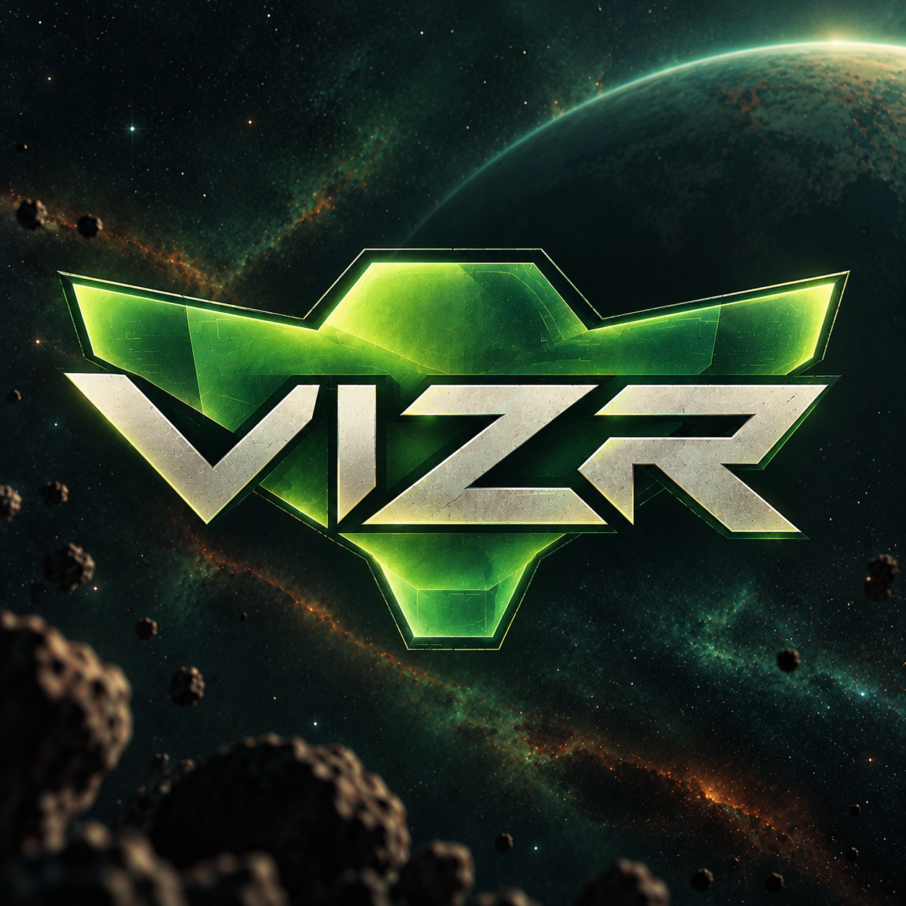

  

# VIZR

VIZR is a finely tuned fork of the Eden emulator for playing **Metroid Prime Remastered in VR**.

You play in first person with tracked hands. The arm cannon is on your right hand, the grapple beam is on your left, and the Scan Visor goes where you look. It works with any OpenXR headset; it is built and tested on a Quest 3 over Virtual Desktop.

You need your own copy of the game, dumped from your own Switch, and the `prod.keys` file from that Switch. This download contains no game files.

> **Please read first**
> - **Your own dump.** The installer asks for your game file and your `prod.keys`. It will not download either.
> - **Set up your HUD for your headset.** Every headset shows a different amount of the picture. After your first start, open the menu (**F1** on the keyboard, or click both sticks and hold them a moment) and move and resize the HUD pieces until they sit where you want them. Your settings are saved.
> - **Keep your save backed up.** Your saves live in `build\eden\bin\user\nand\user\save` under the install folder; copy that folder somewhere safe now and then.

## What you need

- A PC with a current graphics driver (NVIDIA, AMD or Intel).
- A GPU that can draw the game twice per frame at your headset's resolution. A GeForce RTX 4070 runs it at about half load with a Quest 3.
- A VR runtime: Virtual Desktop (with the Streamer on the PC), SteamVR, or the Meta app.
- About 10 GB of free disk space.
- The Microsoft Visual C++ runtime. The installer checks for it and gives you the link if yours is missing or too old.

## Install

1. Download `VIZR-Setup-<version>.exe` from the Releases page and run it. It is not code-signed, so Windows will say "Windows protected your PC": click **More info**, check the file name, then **Run anyway**. No administrator rights are needed.
2. It asks for four things, one page at a time: your `prod.keys`, firmware (skip it; this game does not need it), your game file, and where to install (the default is fine).
3. It puts a VIZR shortcut on the desktop and shows you what it checked.

To play: start your VR runtime, then double-click VIZR. The launcher shows the controls and starts the game.

To upgrade, run the new installer into the same folder; your settings and saves stay. To uninstall, use Windows Settings > Apps > VIZR; it removes everything except your saves and settings.

**Checking a download.** Every release lists SHA-256 hashes in `SHA256SUMS.txt`, and every file is built by this repository's GitHub Actions workflow with a build provenance attestation (`gh attestation verify <file> -R vainamoinen-dev/VIZR`).

## Controls (Quest Touch)

| Control | Action |
|---|---|
| **Right hand** | The arm cannon. Point it where you want to shoot |
| **Right trigger** | Fire (hold to charge); bombs in the morph ball |
| **Right grip** | Missile |
| **A** | Jump; confirm in menus |
| **B** | Map; back in menus |
| **X** | Morph ball |
| **Crouch** | Morph ball too: crouch down to roll into the ball, stand up to come out |
| **Y** | The game's beam-select hold |
| **Left trigger** | Lock on; in the Scan Visor, scan; near a grapple point, grapple |
| **Left hand** | Points at the grapple point you want |
| **Left hand to your head, then flick the left stick** | Change visor: up Combat, right Scan, down Thermal, left X-Ray. A quick tap on the head goes to the next visor you own |
| **Left hand on the cannon, then flick the left stick** | Change beam: up Power, right Wave, down Ice, left Plasma |
| **Left stick** | Move |
| **Right stick** | Turn, in snaps or smoothly (your choice in the menu) |
| **Left stick click** | Recenter |
| **Click both sticks and hold** (or **F1**) | Open or close the menu |
| **Left menu button** | Pause |

Other controllers are mapped onto the same buttons through OpenXR and are untested; please report what works.

## The menu

Press **F1** (with the game window focused) or click both sticks together and hold them a moment. The right hand points, the right trigger clicks and drags, the right stick scrolls, and **B** closes it. The tabs:

- **HUD:** size, distance and height for the whole HUD, then a section for each piece (energy, missiles, threat, visor frame, radar, visor menu, beam menu, messages, boss energy, minimap) with position, size, opacity and distance, and a reset button each. Set these up for your headset first.
- **Comfort:** snap or smooth turning and the snap angle; crouch-to-morph and its depth; what "forward" follows (your body, your head, or a controller); the grapple pick; arm length and left-hand fit; the morph ball and cutscenes in 3D or on a flat screen, with fades and vignettes; head lean.
- **Body:** show your body, its size, and how it stands and leans with your head.
- **Cannon & arms:** where the cannon sits and how big it is; whether the arm follows your body.
- **World:** world scale and eye height.
- **Compatibility:** render scale, headset refresh rate, game frame rate (60, or match your headset up to 90), shader compile mode, GPU accuracy, and a one-click low-end GPU preset.

Settings are saved and kept across upgrades.

## Known issues

- **One tested setup.** One PC with an RTX 4070 and a Quest 3 over Virtual Desktop. Other GPUs, headsets and runtimes should work but have not been tried.
- **90 fps needs headroom.** With "match headset", the game runs at the headset's rate as long as your GPU keeps up. If it falls behind for five seconds, the game drops to 60 for the rest of the session and the menu header says so; the next session tries again.
- **Body direction can lag a fast whole-body turn.** Your body's facing is estimated from the headset and the controllers. Set "forward" to follow your head or a controller in the Comfort tab if you prefer.
- **Grapple pick.** Your left hand picks among the grapple points in view, within a 25-degree cone. A point off to the side is not picked until you look toward it.

## Reporting a problem

Each session writes a folder under `logs\` in the install folder with `launch.txt` and `eden_log.txt`. Open an issue on the Issues page, say what you did and what happened, and attach those two files. They name folders on your PC, so look them over first.

## Licence

VIZR is a fork of [Eden](https://git.eden-emu.dev/eden-emu/eden), GPL-3.0-or-later. The source is this repository; `BUILDING.md` has the build steps. Third-party licences are in `LICENSES/`.

## Not affiliated

Metroid is a trademark of Nintendo. This project is not affiliated with or endorsed by Nintendo, and includes no game files. You need to own Metroid Prime Remastered.
